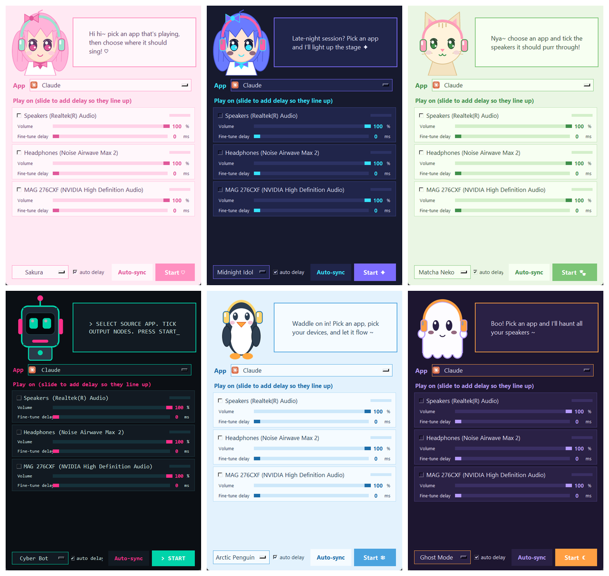

<h1 align="center">Multi-Out Audio</h1>
<p align="center"><b>Play one app through several audio devices at once on Windows, kept in sync automatically.</b><br>
Spotify on your Bluetooth earbuds <i>and</i> your speakers, with no virtual drivers and no setup headaches.</p>

<p align="center">
  <a href="../../releases/latest"></a>
  
  
</p>

<p align="center"></p>

## Why

Windows sends an app's sound to one device. Want a movie on your headphones *and* the TV speakers, a party on two
Bluetooth speakers, or a stream you can hear on both your headset and your room speakers? Windows can't do it.
Virtual-cable tools can, but they're fiddly, and Bluetooth delay makes everything echo. Multi-Out Audio does it in one
small window and fixes the echo for you.

## Install

**Easiest:** download **`MultiOutAudio-Setup-x.y.z.exe`** from the [latest release](../../releases/latest) and run it.
Prefer no install? Grab the portable **`MultiOutAudio.exe`**.

> The app isn't code-signed yet, so Windows SmartScreen may say "unknown publisher". Click **More info → Run anyway**.
> Checksums are in `SHA256SUMS.txt` on the release page. The code is all here and the builds are made by GitHub Actions.

Needs Windows 10 (2004+) or Windows 11.

## Use it

1. Connect your devices and start playing audio in an app.
2. Open Multi-Out Audio, pick the app (it shows the real icon and name), and tick the devices.
3. Press **Start**. Each device has its own **volume** and a live **level bar**, so you can see sound arriving.
4. **Auto-sync:** tick two or more devices, press *Auto-sync*, and hold each device near your microphone. The app plays
   clicks through each device, measures its real delay, and equalises them from then on. *Fine-tune delay* nudges by ear.

Your choices (devices, volumes, delays, theme) are remembered.

The app still plays on its normal Windows device too. Untick that device, or tick it and silence the original by routing
the app to an unused device in Settings > System > Sound > Volume mixer.

## Themes

Sakura · Midnight Idol · Matcha Neko · Cyber Bot · Arctic Penguin · Ghost Mode · **Custom** (drop your own PNG at
`%APPDATA%\bt-app-audio-multi\mascot.png`). Every mascot is an original drawing made for this project, so it's all
MIT-licensed. Want a new one? See [CONTRIBUTING](CONTRIBUTING.md).

## How it works

- **Capture:** Windows' process-loopback API (`ActivateAudioInterfaceAsync` on `VAD\Process_Loopback`) captures only the
  chosen app's audio. No virtual audio driver is installed.
- **Playback:** one WASAPI stream per device, each with a small jitter buffer, its own delay and volume.
- **Sync:** Windows can't report Bluetooth latency, so Auto-sync measures it acoustically (click out, mic in) and stores it per device.

## Build from source

```powershell
git clone https://github.com/SIDDHANTCOOKIE/multi-out-audio
cd multi-out-audio
pip install -r requirements.txt
python run_gui.py
.\build.ps1        # dist\MultiOutAudio.exe
```

CLI: `python -m multiout --list` · `python -m multiout --app spotify.exe --device Speakers --device "Headphones:120:80"`
(`name:delay_ms:volume_pct`).

Releases are built by [GitHub Actions](.github/workflows/release.yml): pushing a `v*` tag builds the exe and the installer.

## Limitations

- Windows 10 2004+ / 11 only.
- Auto-sync needs a microphone that can hear the device (hold earbuds against it).
- Devices run on separate clocks, so very long sessions can drift slightly; the buffer is bounded to correct this.
- A browser's tabs share one audio process, so they're mirrored together.

## License

[MIT](LICENSE). Issues and pull requests welcome.
